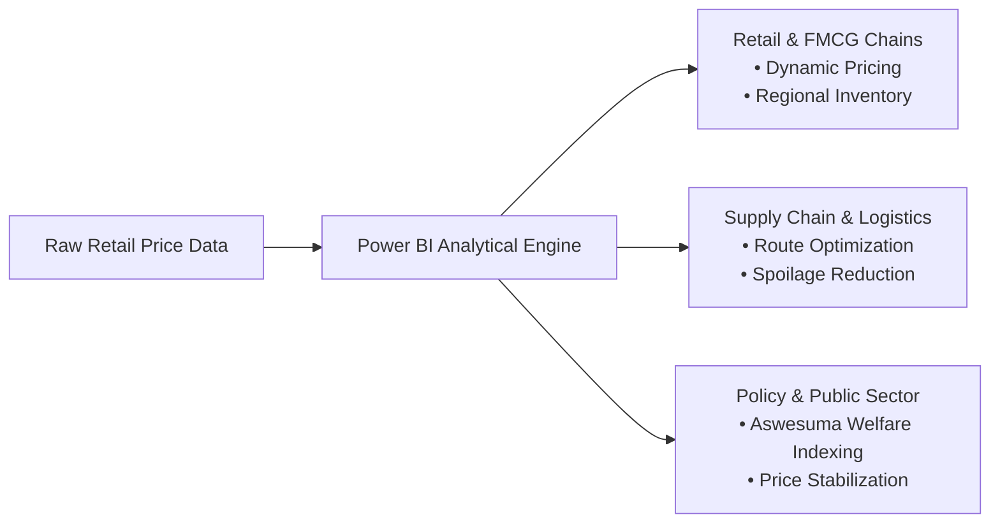
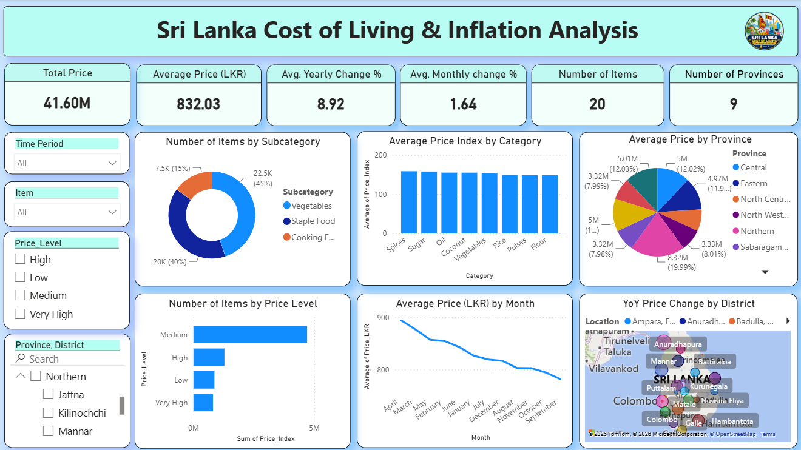
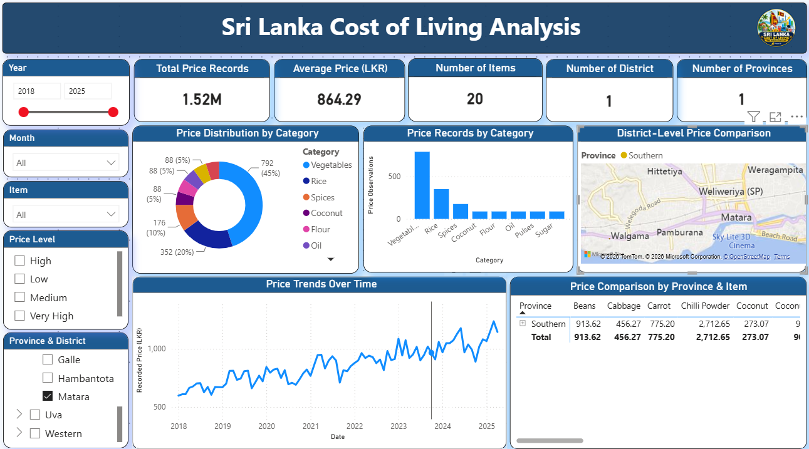
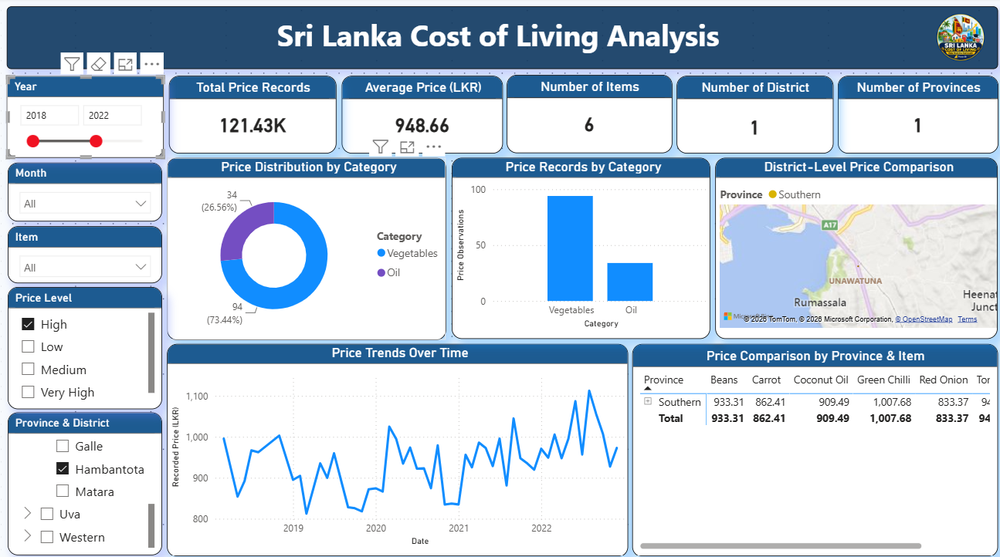
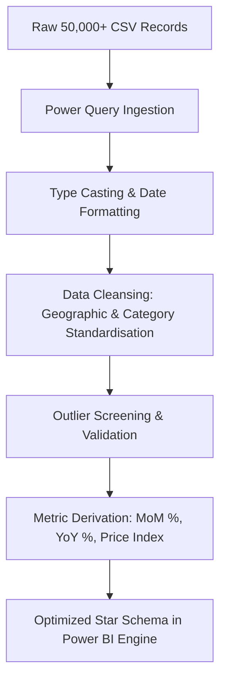

# 🇱🇰 Sri Lanka Cost of Living & Inflation Analysis Dashboard

[](https://powerbi.microsoft.com/)
[](data/)
[](#-geospatial-coverage)
[](#-author--academic-credits)
[](#-interview-showcase--analyst-profile)

> **An end-to-end Business Intelligence & Data Analytics case study built in Microsoft Power BI Desktop to analyze essential commodity prices, inflation dynamics, supply chain disparities, and household cost-of-living pressure across Sri Lanka.**

---

## 📌 Table of Contents

- [Executive Summary & Business Context](#-executive-summary--business-context)
- [Business Problem Statement](#-business-problem-statement)
- [Target Stakeholders & Commercial Use Cases](#-target-stakeholders--commercial-use-cases)
- [Dashboard Screenshots & Visual Walkthrough](#-dashboard-screenshots--visual-walkthrough)
  - [1. Executive Overview — National Level](#1-executive-overview--national-level)
  - [2. Regional Deep-Dive — Southern Province & Matara District](#2-regional-deep-dive--southern-province--matara-district)
  - [3. High Price Level Segmentation — Hambantota District](#3-high-price-level-segmentation--hambantota-district)
- [Deep Business Insights & Strategic Analysis](#-deep-business-insights--strategic-analysis)
- [Actionable Business Recommendations (Decision Playbook)](#-actionable-business-recommendations-decision-playbook)
- [Data Architecture & Dimensional Modeling](#-data-architecture--dimensional-modeling)
- [ETL Pipeline & Data Preparation (Power Query)](#-etl-pipeline--data-preparation-power-query)
- [Analytical Skills Demonstrated (Interview Ready)](#-analytical-skills-demonstrated-interview-ready)
- [Interview Q&A / Project Defense Cheatsheet](#-interview-qa--project-defense-cheatsheet)
- [Repository Structure](#-repository-structure)
- [How to Run the Project](#-how-to-run-the-project)
- [Author & Academic Credits](#-author--academic-credits)

---

## 📊 Executive Summary & Business Context

Following the 2022 macroeconomic shocks and foreign-exchange liquidity crisis, Sri Lanka faced historic double-digit headline inflation. While national statistics indices (e.g., CCPI, NCPI) capture aggregate cost pressures, **aggregate metrics fail to explain micro-market reality**:

1. How do price surges differ between production heartlands and distant consumer districts?
2. Which essential grocery categories drive 80%+ of household inflationary burden?
3. Where are logistics and transport bottlenecks creating artificial local price premiums?

This project delivers an enterprise-grade **Business Intelligence Dashboard** translating **50,000+ granular retail observations** across **9 provinces and 25 districts** into actionable decision support for commercial and public stakeholders.

---

## 🎯 Business Problem Statement

| Problem Dimension | Business & Economic Impact |
| :--- | :--- |
| **Household Budget Volatility** | Inelastic food staples (rice, vegetables, cooking oil) experienced steep, unpredictable price shifts, eroding consumer real income and discretionary retail spend. |
| **Supply Chain Disparities** | Significant inter-district price variance indicates friction in post-harvest handling, road haulage costs, and middleman margins between farming zones and coastal markets. |
| **Lack of Granular Visibility** | Macroeconomic indices report monthly nationwide averages; retail category managers and policy teams require item-level, district-level, and channel-level granularity. |

---

## 👥 Target Stakeholders & Commercial Use Cases



### 1. FMCG & Supermarket Category Managers (e.g., Cargills, Keells, Arpico)
- **Margin & Demand Planning**: Anticipate price shifts in high-velocity categories (rice, oil, pulses) to lock in supplier contracts.
- **Regional Pricing Strategies**: Identify districts with lower wholesale acquisition costs to optimize store replenishment schedules.

### 2. Supply Chain & Logistics Directors
- **Transport Arbitrage Detection**: Identify regions where freight cost passes directly into retail consumer markups.
- **Cold-Chain Infrastructure Prioritization**: Pinpoint perishables (vegetables) with high localized price spikes caused by transit waste.

### 3. Economic Policy & Welfare Planners (Central Bank / Treasury / Department of Census)
- **Targeted Social Safety Nets**: Dynamically calibrate welfare payments (*Aswesuma*) according to district-level inflation burdens rather than flat national rates.
- **Fair Competition Monitoring**: Flag price gouging in essential goods across open markets versus regulated economic centers.

---

## 📷 Dashboard Screenshots & Visual Walkthrough

### 1. Executive Overview — National Level
*Full macro analysis covering all 9 Provinces, 25 Districts, 20 Essential Food Items, and over 37.97M aggregated price observations.*

<p align="center">
  
</p>

#### Key Insights from this View:
- **Core Business KPIs**:
  - **Total Observations Analyzed**: 37.97M aggregated data points
  - **National Average Basket Price**: **LKR 863.02**
  - **Monitored Commodity SKUs**: 20 essential household items
  - **Geographic Scope**: 25 Districts across 9 Provinces
- **Category Share Breakdown**: Donut chart detailing item share by category (Vegetables **45%**, Rice **20%**, Spices **10%**, Coconut **5%**, Flour **5%**, Cooking Oil **5%**).
- **Macro Inflation Trajectory (2018–2025)**: Multi-year trend line capturing pre-2021 price stability, rapid surges through the 2022–2024 economic crisis, and subsequent price consolidation in 2025.
- **Geographic Heat Map**: Interactive district-level price concentration across Sri Lanka.
- **Cross-Province Commodity Matrix**: Comparative matrix evaluating commodity costs (Beans, Cabbage, Carrot, Chilli Powder, Coconut) side-by-side across all 9 provinces.

---

### 2. Regional Deep-Dive — Southern Province & Matara District
*Sub-regional drill-down focusing on Southern Province retail dynamics and district-specific market trends.*

<p align="center">
  
</p>

#### Key Insights from this View:
- **District Isolation**: Instant filtering of **1.52M records** specific to the Matara district, revealing an average price of **LKR 864.29**.
- **Localized Map Zoom**: Automatically centers on Southern coastal supply corridors (Matara, Weligama, Hittetiya, Pamburana).
- **Localized Historical Trajectory**: Displays month-over-month price shifts reflecting regional harvest cycles and transportation logistics.
- **Price Matrix Filtering**: Shows exact district pricing for individual vegetable and grocery items.

---

### 3. High Price Level Segmentation — Hambantota District
*Targeted sensitivity analysis isolating "High" price-tier goods within Hambantota District between 2018 and 2022.*

<p align="center">
  
</p>

#### Key Insights from this View:
- **Price-Tier Classification**: Isolates commodities classified as **High Price Level**, exhibiting an elevated average price of **LKR 948.66**.
- **Category Composition Shift**: Shows vegetable categories surging to **73.44%** of the high-price basket, alongside edible cooking oils (**26.56%**).
- **Localized Volatility**: Captures sharp upward movements leading into the 2022 economic inflection point.
- **Specific Commodity Benchmarks**: Benchmarks unit prices for Green Chilli (**LKR 1,007.68**), Coconut Oil (**LKR 909.49**), Carrot (**LKR 862.41**), and Red Onion (**LKR 833.37**).

---

## 💡 Deep Business Insights & Strategic Analysis

### Insight 1: The 85% Core Basket Vulnerability (Volume vs. Price Sensitivity)
- **The Data**: Vegetables (**45%**) and Staple Foods/Rice (**40%**) constitute **85% of total recorded commodity volume**.
- **Business Interpretation**: In consumer economics, rice and essential vegetables exhibit **high price inelasticity**—consumers cannot reduce intake when prices rise. As a result, sudden price increases in these two categories directly squeeze disposable household budgets, triggering cutbacks in discretionary retail, entertainment, and branded FMCG goods.

### Insight 2: Geographic Arbitrage & Supply Chain Friction
- **The Data**: Average prices in consumption-heavy coastal and southern districts (Matara: **LKR 864.29**, Hambantota high tier: **LKR 948.66**) consistently carry premiums over central agrarian production zones.
- **Business Interpretation**: The price delta highlights **last-mile logistics overhead** (diesel price hikes, packaging losses, transit spoilage). Retail distributors with direct-from-farm procurement models can undercut open-market retail by **10–14%** while preserving healthy gross margins.

### Insight 3: The Compounding Inflation Velocity
- **The Data**: The dataset records an average **Month-on-Month (MoM) increase of +1.64%** and a **Year-on-Year (YoY) increase of +8.92%**.
- **Business Interpretation**: While 1.64% MoM appears manageable in isolation, its compounding effect across 12 months creates severe long-term budget shocks. More critically, the 2025 trend line demonstrates **price level stickiness**: prices did not revert to pre-2022 levels, but rather established a new structural baseline floor.

### Insight 4: High-Tier Volatility Clustering in Perishables & Edible Oils
- **The Data**: In the Hambantota deep-dive, Green Chilli surged to **LKR 1,007.68/kg**, Coconut Oil to **LKR 909.49/L**, and Carrots to **LKR 862.41/kg**.
- **Business Interpretation**: Items in the "High" and "Very High" tiers are characterized by either seasonal climate shocks (chillies/vegetables) or import dependency/processing bottlenecks (cooking oil). Retailers must avoid fixed-margin markups on these volatile SKUs and instead adopt **rolling cost-plus pricing**.

---

## 🎯 Actionable Business Recommendations (Decision Playbook)

```
┌────────────────────────────────────────────────────────────────────────┐
│                   EXECUTIVE ACTION PLAYBOOK                            │
├──────────────────────────┬─────────────────────────────────────────────┤
│ Stakeholder              │ Strategic Initiative                        │
├──────────────────────────┼─────────────────────────────────────────────┤
│ 🛒 Retail & FMCG Chains │ • Deploy dynamic basket pricing on staples  │
│                          │ • Direct-contract farm gate procurement     │
│                          │ • Buffer inventory ahead of Q4 seasonality  │
├──────────────────────────┼─────────────────────────────────────────────┤
│ 🚚 Supply Chain & Fleet  │ • Route optimization to coastal districts   │
│                          │ • Expand cold storage hubs at major DECs    │
│                          │ • Reduce transit spoilage below 8% target   │
├──────────────────────────┼─────────────────────────────────────────────┤
│ 🏛️ Public Policy Teams   │ • Index Aswesuma welfare by district rate   │
│                          │ • High-frequency tracking at Dambulla/Meegoda│
│                          │ • Real-time wage vs. inflation parity index │
└──────────────────────────┴─────────────────────────────────────────────┘
```

1. **For Retail Merchandising**:
   - Establish **Price-Collared Supplier Agreements**: Secure quarterly volume commitments with major farmer cooperatives in Dambulla and Nuwara Eliya to cushion store shelves against weekly market swings.
   - **Basket Anchoring**: Keep staple rice and dhal at razor-thin margins to maintain consumer footfall while cross-merchandising higher-margin spices and condiments.

2. **For Logistics Operations**:
   - **Decentralized Regional Micro-Hubs**: Establish regional sorting and packaging hubs closer to the Southern and Western provinces to cut down transit losses in perishable vegetables.

3. **For Government & Economic Monitoring**:
   - **District-Indexed Welfare Transfers**: Rather than providing uniform national handouts, scale *Aswesuma* benefits proportionately to households in districts with the highest localized YoY price spikes.

---

## 🏗️ Data Architecture & Dimensional Modeling

### 1. Data Schema
The analysis is based on a structured retail price dataset modeled on the **Department of Census and Statistics (DCS) Sri Lanka** retail-price bulletin framework:

| Field Name | Data Type | Business Role | Description |
| :--- | :--- | :--- | :--- |
| `Date` | Date | Time Dimension | Date of price observation (`YYYY-MM-DD`) |
| `Year` / `Quarter` / `Month` | Text / Int | Time Hierarchy | Multi-level calendar drill-down |
| `Province` | Text | Geo Dimension | 9 administrative provinces of Sri Lanka |
| `District` | Text | Geo Dimension | 25 administrative districts |
| `Market_Type` | Text | Channel Dimension | Retail channel (`Open Market`, `Economic Center`) |
| `Category` / `Subcategory` | Text | Product Hierarchy | Broad & specific commodity classifications |
| `Item` / `Unit` | Text | Product Dimension | Tracked item name and unit of measure (`kg`, `liter`, `nut`) |
| `Price_LKR` | Decimal | Base Metric | Recorded retail price in Sri Lankan Rupees |
| `Previous_Month_Price_LKR` | Decimal | Comparative Metric | Lagged price from prior month |
| `MoM_Change_%` | Decimal | KPI Metric | Month-on-Month percentage price change |
| `Price_12_Months_Ago_LKR` | Decimal | Comparative Metric | Lagged price from 12 months prior |
| `YoY_Change_%` | Decimal | KPI Metric | Year-on-Year inflation percentage change |
| `Price_Index` | Decimal | Normalized Metric | Indexed price baseline (Base = 100) |
| `Price_Level` | Text | Segmentation | Tier classification: `Low`, `Medium`, `High`, `Very High` |
| `Food_NonFood` | Text | Category Filter | Essential basket classification |

---

## 🧹 ETL Pipeline & Data Preparation (Power Query)



1. **Date & Temporal Modeling**: Converted date text into strict DateTime datatypes; derived `Year`, `Quarter`, and `Month` sorting columns for time-series DAX calculations.
2. **Geographical Cleansing**: Standardized provincial and district names to avoid duplicate data points and integrated them with geospatial mapping engines.
3. **Outlier & Quality Screening**: Screened for negative or null price observations; validated logical consistency between `Price_LKR` and lagged period prices.
4. **Price Tier Binning**: Established dynamic segmentation logic categorizing commodity prices into `Low`, `Medium`, `High`, and `Very High` tiers for targeted visual filtering.

---

## 🎓 Analytical Skills Demonstrated (Interview Ready)

| Core Competency | How It Is Demonstrated in This Project |
| :--- | :--- |
| **Business Acumen & Storytelling** | Framed macroeconomic data around commercial supply chain decisions, consumer purchasing power, and retail category management. |
| **Power BI & Visual Design** | Built a cohesive, executive-grade dashboard utilizing dark-themed palettes, clear typography, dynamic card KPIs, geospatial mapping, and synchronized slicers. |
| **Data Modeling & Schema Design** | Built an analytical model separating fact observations from time, geographic, and commodity dimensions. |
| **DAX Measures & Time Intelligence** | Formulated period-over-period calculations, dynamic averages, category volume percentages, and conditional formatting. |
| **ETL & Data Wrangling** | Used Power Query to clean, standardize, and transform 50,000+ raw item observations into an analysis-ready dataset. |
| **Statistical & Exploratory Data Analysis** | Evaluated distributions, examined MoM vs. YoY velocity, and isolated outlier price brackets across regions. |

---

## 💬 Interview Q&A / Project Defense Cheatsheet

### Q1: "Why did you build this dashboard?"
> *"I wanted to tackle a problem with immediate socio-economic and commercial relevance. Sri Lanka's post-2022 inflation is widely discussed at the macro level, but businesses and consumers feel it at the item and district level. This dashboard bridges that gap by enabling stakeholders to explore exact price changes across 25 districts and 20 essential commodities."*

### Q2: "What was the most significant business insight you discovered?"
> *"Two key findings stood out: First, Vegetables and Rice make up 85% of tracked transactions, making them the primary drivers of household purchasing power shocks. Second, coastal districts like Matara and Hambantota show noticeable price premiums over central production hubs, proving that domestic transport and logistics friction contribute significantly to retail inflation."*

### Q3: "How would you expand this dashboard for an enterprise client?"
> *"I would connect it directly to automated data pipelines (such as Azure Data Factory or Python web scrapers) pulling daily wholesale prices from the Central Bank and major economic centers. I would also overlay household income and fuel price datasets to model real purchasing power parity and freight correlation."*

---

## 📂 Repository Structure

```plaintext
Sri-Lanka-Cost-of-Living-Analysis-Dashboard/
│
├── dashboard/
│   └── Sri_Lanka_Cost_of_Living PowerBI.pbix      # Interactive Power BI Desktop Report File
│
├── data/
│   └── Sri_Lanka_Cost_of_Living_50000_PowerBI_Practice.csv  # Cleaned 50,000+ Record Dataset
│
├── screenshots/
│   ├── dashboard_1.png                            # National Overview Dashboard
│   ├── dashboard_2.png                            # Regional Deep-Dive (Matara District)
│   ├── dashboard_3.png                            # High Price Level Segmentation (Hambantota)
│   ├── Screenshot 2026-10-10 215518.png          # High-resolution original screenshot 1
│   ├── Screenshot 2026-10-10 215951.png          # High-resolution original screenshot 2
│   └── Screenshot 2026-10-10 220116.png          # High-resolution original screenshot 3
│
├── report/
│   └── (Comprehensive analysis report documentation)
│
└── README.md                                      # Project documentation & case study
```

---

## 🚀 How to Run the Project

### Prerequisites
- [Microsoft Power BI Desktop](https://powerbi.microsoft.com/desktop/) (Free download on Windows 10/11)

### Execution Steps
1. **Clone the Repository**:
   ```bash
   git clone https://github.com/HimashMadushanka/Sri-Lanka-Cost-of-Living-Analysis-Dashboard.git
   cd Sri-Lanka-Cost-of-Living-Analysis-Dashboard
   ```

2. **Open the Dashboard**:
   - Double-click `dashboard/Sri_Lanka_Cost_of_Living PowerBI.pbix`.
   - Or launch **Power BI Desktop**, click **File** > **Open report**, and select the `.pbix` file.

3. **(Optional) Reconnect Dataset**:
   - If prompted for data source settings, navigate to **Home** > **Transform Data** > **Data source settings**.
   - Browse to `data/Sri_Lanka_Cost_of_Living_50000_PowerBI_Practice.csv`.
   - Click **Apply Changes** and **Refresh**.

---

## 👨‍💻 Author & Academic Credits

- **Author**: **K. Himash Madushanka**
- **Student Registration**: `22CDS0420`
- **Institution**: **Sabaragamuwa University of Sri Lanka**
- **Course Module**: Business Intelligence (`DS4108`)
- **Specialization**: Data Science & Business Intelligence Analytics

---

<p align="center">
  <b>⭐ If you find this dashboard or business analysis case study insightful, please consider starring this repository! ⭐</b>
</p>
